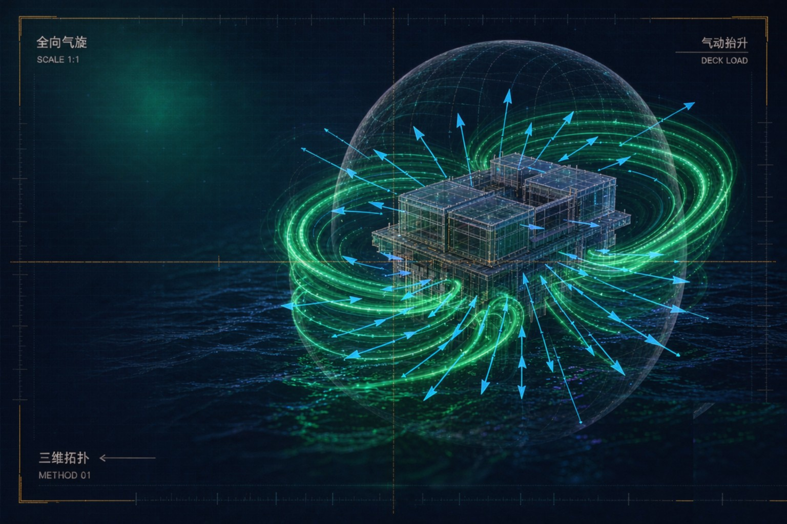

<!-- SINOSHOP SYSTEM STRIP:BEGIN -->
<table align="center">
<tr>
<td><b>🌊 SINOSHOP 星系</b></td>
<td><a href="https://gitee.com/sinoshop/sinoshop-hub">星系导航</a></td>
<td><a href="https://sinoshop-open.github.io/webpage/">官网</a></td>
<td><a href="https://sinoshop-open.github.io/webpage/docs/evidence/index.html">验证证据</a></td>
<td><a href="https://sinoshop-open.github.io/webpage/docs/datasets/index.html">数据集总览</a></td>
<td><a href="https://sinoshop-open.github.io/webpage/whitepaper.html">技术白皮书</a></td>
</tr>
</table>
<!-- SINOSHOP SYSTEM STRIP:END -->
<!-- STAR:HERO:START -->

  

# CHALLENGE-010 · Windrider

### Omnidirectional Cyclone 3D Topological Aerodynamic Lift Algorithm

 

> **观天之道，执天之行，造福人民。**　*Observe Nature's Order, Align with Ocean's Rhythm, Benefit All People.*
> **碳基硅基共舞** —— 开源工程硬核科幻 · 与全球工程师同场解题。

 

<code>🌀 全向气旋</code> &nbsp; <code>🧊 三维拓扑</code> &nbsp; <code>🌀 气动抬升</code> &nbsp; <code>🎁 知识悬赏</code> &nbsp; 

 

### 🌐 星系导航 · STAR NAVIGATION

**🌐 [SINOPORT 官网展示页](https://sinoshop-open.github.io/webpage/) ｜ 💻 [SINOPORT 主仓库](https://gitee.com/sinoshop/SinoPORT) ｜ 🐙 [GitHub 镜像组织](https://github.com/SINOSHOP-OPEN)**

<!-- STAR:HERO:END -->

# 🏆 CHALLENGE-010: Windrider · Omnidirectional Cyclone 3D Topological Aerodynamic Lift Algorithm

**USS v2.2.3d · Ultimate Defense Edition**

> *Observe Nature's Order, Align with Ocean's Rhythm, Benefit All People.*

---

🔗 **SINOSHOP Ecosystem Navigation**: [🌐 SINOPORT 官网展示页](https://sinoshop-open.github.io/webpage/) · [💻 SINOPORT 主仓库](https://gitee.com/sinoshop/SinoPORT) · [🐙 GitHub 镜像组织](https://github.com/SINOSHOP-OPEN) · [sinoshop-os Mother Platform](https://gitee.com/sinoshop/sinoshop-os) · [Paradigm Interface](https://github.com/SINOSHOP-OPEN/SINOSHOP-Sandbox/tree/main/api/R21A-MIND) · [Product Catalog](https://github.com/SINOSHOP-OPEN/SINOSHOP-Sandbox/tree/main/products) · [Getting Started Tasks](https://github.com/SINOSHOP-OPEN/SINOSHOP-Sandbox/issues)

📖 **"Mending the Sky" Chapter 1: Typhoon Chaos Approaches** — Open-source hard sci-fi engineering, Venturi cavitation bounty now live #IJSH0I

---

## 📐 Mission Background

The SINOSHOP Maritime Transportation Hub (Sea-Sky Observatory) spans **3600 meters** in length and **1188 meters** in width. At both the north and south ends, **300-meter** "Oceanic Dujiangyan" wave-dissipating lift platforms extend outward, with a **282-meter** fully open-air observatory core zone at the center.

**Core Challenge**: When a Category 5 super typhoon strikes head-on, how can we ensure the formation of an absolutely stable relative calm-air zone above the central observatory?

---

## 🎯 Mission Objective

Perform multi-field coupled omnidirectional cyclone simulation on the following:

- The 300-meter steep-slope lift platforms at both ends
- The nine-longitudinal overall shell structure

**Key Calculation**: Resolve the boundary-layer high-altitude parabolic trajectory formed by airflow wall-attachment separation under **360° omnidirectional dynamic rotating shear** conditions of a Category 5 super typhoon.

---

## 🔴 Core Metrics (Non-Negotiable)

| Metric | Requirement |
| :--- | :--- |
| Wind Speed | v∞ ≥ 65 m/s (Category 5 super typhoon) |
| Wind Direction | 360° omnidirectional dynamic rotating shear, rotation period covering 1h–6h |
| Physical Mechanism | **No external electric pump drainage** — geometry-based passive energy dissipation only |
| Wind Speed Attenuation | ≥ 75% |
| Central Calm Zone | Formation of an absolutely 3D-stable relative calm-air shear vortex bottom layer above the 282m observatory |
| High-Frequency Residual | PID system only fine-tunes < 300μm micro-vibrations |

---

## 🧩 Physical Model Constraints

The global aerodynamic solution must synergistically integrate the following geometries:

| Geometry | Function |
| :--- | :--- |
| **North & South 300m "Oceanic Fish Mouth"** | Initial lift effect |
| **3rd & 7th Longitudinal Flat Elliptical PV Shields** | Geometric curvature synergy |
| **1st & 9th Longitudinal Ecological Mangrove Belts** | Live damping coefficient dynamic degradation edge conditions |
| **Nine-Longitudinal Overall Shell** | Full boundary-layer separation path |

---

## ⚙️ Concurrent Black Swan Scenarios (TRL5 Gate)

Proposed solutions must pass the following extreme concurrent destructive tests:

| Test Scenario | Description |
| :--- | :--- |
| **18m Maximum Wave Height** | Oblique impact |
| **50% Virtual Anchor Hammer (VIR) Failure** | Interruption |
| **9m Isolation Waterway Ferry EM Short Circuit** | Transit system failure |
| **Data Center Thermal Management Loop** | Sudden cavitation |
| **Mangrove Live Damping Coefficient** | Dynamic degradation |

**Passing Red Line**: Maximum instantaneous tilt angle ≤ 3°, Sovereign Hash Chain data integrity 100%.

---

## 🏅 Knowledge Rewards

Solutions that pass the TRL5 gate will receive:

| Reward | Description |
| :--- | :--- |
| **Global Unique STI Identifier** | Permanent digital identity code |
| **SHA-3-256 Sovereign Hash** | Permanent digital proof of contribution |
| **Sino-Fuel Ecosystem Benefits** | — |
| — Deep-sea compute free allocation (PoK weight-based) | — |
| — IMTA premium marine product digital delivery rights | — |
| — Priority settlement discounts for global green hydrogen refueling | — |

---

## 📥 Submission Guidelines

| Item | Link/Description |
| :--- | :--- |
| **Main Repository** | [https://github.com/SINOSHOP-OPEN/SINOSHOP-Platform](https://github.com/SINOSHOP-OPEN/SINOSHOP-Platform) |
| **Sandbox Simulation Platform** | [SINOSHOP-Sandbox](https://github.com/SINOSHOP-OPEN/SINOSHOP-Sandbox) — Complete simulation verification in the sandbox, then submit results to this challenge entry |
| **Technical Specifications** | See USS v2.2.3d complete strategic documents in `/docs/` directory |

---

> *Benefiting others is the best way to benefit oneself.*

---

## 📬 Contact & Community

🌊 **SINOSHOP** — Self-sustaining Intelligent Networked Oceanic Stable Habitat Operating Platform

Based on Submerged Floating Tunnel (SFT) core technology, building a self-floating, intelligent, networked marine city operating platform.

- 🏠 **Project Homepage**: [https://sinoshop-open.github.io/webpage/](https://sinoshop-open.github.io/webpage/)
- 📂 **Open Source Repository**: [https://gitee.com/sinoshop/sinoshop-os](https://gitee.com/sinoshop/sinoshop-os)
- 🌐 **GitHub International Mirror**: [SINOSHOP-OPEN](https://github.com/SINOSHOP-OPEN)
- 📧 **Contact Email**: standards@sinoshop.org

---

> 🌊 *Observe Nature's Order, Align with Ocean's Rhythm, Benefit All People.*  
> 🌊 *Sea Generates Power → Power Sustains Ships → Ships Bridge Cities → Cities Benefit People → Aerospace for All → Harmony for All Beings.*  
> ✨ *Loyalty shines through ages; benevolence spreads across seasons.*

---

🇨🇳 **中文版本**: [在 Gitee 上查看](https://gitee.com/sinoshop/SINOSHOP-Sandbox)

---

*Last Updated: 2026-09-02 | SINOSHOP-Sandbox v1.0*

> **利众是最佳方式的自利。**
> 
> 联系邮箱：standards@sinoshop.org
